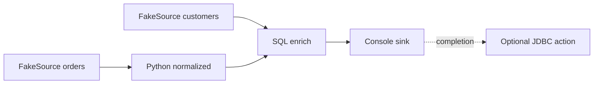

# Apache SeaTunnel


[](https://github.com/apache/seatunnel/actions/workflows/build_main.yml)
[](https://s.apache.org/seatunnel-slack)
[](https://twitter.com/ASFSeaTunnel)
[](https://deepwiki.com/apache/seatunnel)

## Overview
SeaTunnel is a multimodal, high-performance, distributed data integration tool, capable of synchronizing vast amounts of data daily. It's trusted by numerous companies for its efficiency and stability.

## Why Choose SeaTunnel
SeaTunnel addresses common data integration challenges:
- **Diverse Data Sources**: Seamlessly integrates with hundreds of evolving data sources.
- **Multimodal Data Integration**: Supports the integration of video, images, binary files, structured and unstructured text data.
- **Complex Synchronization Scenarios**: Supports various synchronization methods, including real-time, CDC, and full database synchronization.
- **Resource Efficiency**: Minimizes computing resources and JDBC connections for real-time synchronization.
- **Quality and Monitoring**: Provides data quality and monitoring to prevent data loss or duplication.

## Key Features
- **Diverse Connectors**: Offers support for over 160 connectors, with ongoing expansion.
- **Batch-Stream Integration**: Easily adaptable connectors simplify data integration management.
- **Distributed Snapshot Algorithm**: Ensures data consistency across synchronized data.
- **Multi-Engine Support**: Works with SeaTunnel Zeta Engine, Flink, and Spark.
- **JDBC Multiplexing and Log Parsing**: Efficiently synchronizes multi-tables and databases.
- **High Throughput and Low Latency**: Provides high-throughput data synchronization with low latency.
- **Real-Time Monitoring**: Offers detailed insights during synchronization.

## SeaTunnel Workflow


Configure jobs, select execution engines, and parallelize data using Source Connectors. Easily develop and extend connectors to meet your needs.

## Supported Connectors
- [Source Connectors](https://seatunnel.apache.org/docs/connectors/source)
- [Sink Connectors](https://seatunnel.apache.org/docs/connectors/sink)
- [Transform Connectors](https://seatunnel.apache.org/docs/transforms)

## Getting Started
Download SeaTunnel from the [Official Website](https://seatunnel.apache.org/download).
Choose your runtime execution engine:
- [SeaTunnel Zeta Engine](https://seatunnel.apache.org/docs/getting-started/locally/quick-start-seatunnel-engine)
- [Spark](https://seatunnel.apache.org/docs/getting-started/locally/quick-start-spark)
- [Flink](https://seatunnel.apache.org/docs/getting-started/locally/quick-start-flink)

## Experimental Flink YAML DAG

This branch contains an experimental Flink 1.20 DAG runner for validating a
YAML-first job shape. A graph declares named nodes and their `inputs`; the
runner resolves the dependencies, creates one shared Flink environment, and
submits one job. A node can be a SeaTunnel source, the existing Python
transform, a bounded Batch SQL query, a SeaTunnel sink, or a small control
action. The legacy `source` / `transform` / `sink` configuration remains
unchanged.



The minimal validation flow is in
[`examples/flink/graph/fake-python-sql-console.yaml`](examples/flink/graph/fake-python-sql-console.yaml).
It demonstrates two sources, a Python row transform, a multi-input SQL node,
and one sink. The PostgreSQL variant keeps connection values as runtime
variables in [`examples/flink/graph/postgres-python-jdbc.yaml`](examples/flink/graph/postgres-python-jdbc.yaml).
The lifecycle variant adds task-level JDBC preparation and reconciliation nodes in [`examples/flink/graph/postgres-python-jdbc-recon.yaml`](examples/flink/graph/postgres-python-jdbc-recon.yaml).

`inputs` expresses both data and lifecycle dependencies. A control action such as `prepare` runs before Flink submission; a node consuming a sink completion such as `recon` runs after the Flink job succeeds. These actions run once in the client orchestration layer. They are not per-record operators and are not part of the Flink checkpoint or sink transaction boundary.

The current runner targets Flink 1.20.x (validated locally with Flink 1.20.5):

```bash
./mvnw -pl seatunnel-core/seatunnel-flink-starter/seatunnel-flink-20-starter \
  -DskipITs -DskipTests package
FLINK_HOME=/Users/xujiawei/software/flink/flink-1.20.5
java \
  -Dseatunnel.transform.python.enabled=true \
  -Dseatunnel.transform.python.allowed-executables=/opt/homebrew/bin/python3 \
  -cp "target/seatunnel-python-transform-flink20-private-3.0.0-SNAPSHOT/lib/seatunnel-flink-20-starter.jar:target/seatunnel-python-transform-flink20-private-3.0.0-SNAPSHOT/lib/connector-fake-3.0.0-SNAPSHOT-2.12.15.jar:target/seatunnel-python-transform-flink20-private-3.0.0-SNAPSHOT/lib/connector-console-3.0.0-SNAPSHOT-2.12.15.jar:target/seatunnel-python-transform-flink20-private-3.0.0-SNAPSHOT/lib/seatunnel-transforms-v2.jar:$FLINK_HOME/lib/*" \
  org.apache.seatunnel.core.starter.flink.graph.execution.FlinkGraphMain \
  examples/flink/graph/fake-python-sql-console.yaml
```

The graph API and current limits are documented in
[`docs/zh/architecture/flink-yaml-dag.md`](docs/zh/architecture/flink-yaml-dag.md)
and its [English version](docs/en/architecture/flink-yaml-dag.md). This is an
experimental branch: the checked-in evidence covers parser, planner, node
contracts, the local Flink SQL bridge, and one shared-job submission. A real
PostgreSQL run still requires the connector and JDBC driver packages to be
assembled for the target deployment.

Verified locally: the focused graph suite passes 31 tests, the selected Flink
starter packages successfully against Flink 1.20.5 dependencies, and the Fake
→ Python → SQL → Console example exits with code 0 when Python security is
explicitly enabled. The supplied PostgreSQL endpoint accepts TCP connections;
a fresh SQL probe still requires a local PostgreSQL client or Python driver.
The private selected-module archive is generated at
`target/seatunnel-python-transform-flink20-private-3.0.0-SNAPSHOT.tar.gz`.

## Multimodal Data Integration
- Most data integration tools support structured and unstructured text data, and SeaTunnel does as well. Simply refer to the desired Source/Sink to use.
- For integrating video, images, and binary files with SeaTunnel, please refer to the documentation for detailed instructions.

## Apache SeaTunnel Tools
SeaTunnel Tools provides a range of peripheral tools, including Apache SeaTunnel Mcp Server, etc, please refer to [SeaTunnel Tools](https://github.com/apache/seatunnel-tools).

## Users
Companies and organizations worldwide use SeaTunnel for research, production, and commercial products. 
Explore real-world use cases of SeaTunnel, such as JP morgan, S7, JDT, Bytedance, Tencent Cloud. More use cases can be found on the [SeaTunnel Users](https://seatunnel.apache.org/user).

## Code of Conduct
Participate in this project in accordance with the Contributor Covenant [Code of Conduct](https://www.apache.org/foundation/policies/conduct.html).

## Contributors
We appreciate all developers for their contributions. See the [List Of Contributors](https://github.com/apache/seatunnel/graphs/contributors).

## How to Compile
Refer to this [Setup](https://seatunnel.apache.org/docs/developer/setup) for compilation instructions.

## Contact Us
- Mail list: **dev@seatunnel.apache.org**. Subscribe by sending an email to `dev-subscribe@seatunnel.apache.org`.
- Slack: [Join SeaTunnel Slack](https://s.apache.org/seatunnel-slack)
- Twitter: [ASFSeaTunnel on Twitter](https://twitter.com/ASFSeaTunnel)

## Landscapes
SeaTunnel enriches the [CNCF CLOUD NATIVE Landscape](https://landscape.cncf.io/?landscape=observability-and-analysis&license=Apache+License+2.0).

## License
[Apache 2.0 License](LICENSE)

## Frequently Asked Questions

### 1. How do I install SeaTunnel?

Follow the [Local Deployment](https://seatunnel.apache.org/docs/getting-started/locally/deployment) on SeaTunnel website to get 
started quickly.
Please refer to the [Cluster Deployment](https://seatunnel.apache.org/docs/engines/zeta/hybrid-cluster-deployment)

### 2. Where can I find documentation and tutorials?
[Official Documentation](https://seatunnel.apache.org/docs) includes detailed guides and tutorials to help you get started.

### 3. Is there a community or support channel?
You can submit an issue on [GitHub Issues](https://github.com/apache/seatunnel/issues).
Join our Slack community [SeaTunnel Slack](https://s.apache.org/seatunnel-slack).
More information, please refer to [FAQ](https://seatunnel.apache.org/docs/faq). 

### 4. How can I contribute to SeaTunnel?
We welcome contributions! Please refer to our [Contribution Guidelines](https://seatunnel.apache.org/docs/developer/coding-guide) for details.
