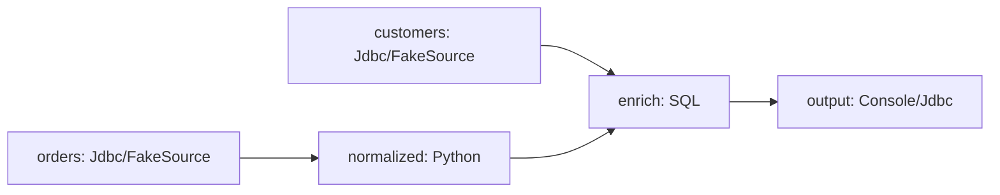

# Flink YAML DAG (experimental)

This experimental runner targets Flink 1.20.x. YAML declares named nodes and their `inputs`; the runtime infers dependencies, performs a deterministic topological sort, registers every operator in one shared `StreamExecutionEnvironment`, and calls `execute` once.



```yaml
nodes:
  orders:
    plugin: Jdbc
    operation: read
    config: { ... }
  normalize:
    plugin: Python
    operation: map
    inputs: [orders]
    config: { ... }
  enrich:
    plugin: sql
    operation: query
    inputs: [normalize, customers]
    config:
      query: SELECT ... FROM normalize JOIN customers ...
```

Node IDs are the table names available to SQL. `inputs` accepts a list or a mapping from SQL alias to upstream node. `runtime.parallelism` is optional; the FakeSource plus Batch SQL local example sets it to `1`, and deployments can tune it for their sources and operators. The parser rejects unknown graph, runtime, and node fields while keeping `config` opaque until the selected plugin validates it.

The current validation set is `FakeSource`, `Jdbc`, `Python`, `sql`, `Console`, and `jdbc_action`. JDBC source and sink nodes use the existing SeaTunnel Connector-V2 configuration contract. Python keeps the existing `source_code` or `source_code_path`, `columns`, and `process(row, context)` contract. SQL currently requires bounded, insert-only inputs and is intended for Batch queries such as INNER JOIN.

Execution order comes from the graph, not YAML order. A root control action with no inputs runs before Flink submission; a terminal action consuming completion values runs after the Flink job finishes. Sources, transforms, SQL, and sinks remain data graph nodes, while control actions do not become fake data streams.

Local verification uses `/Users/xujiawei/software/flink/flink-1.20.5`; Python transforms also require the explicit security enablement and interpreter allowlist. Tests cover YAML parsing, variable substitution, dependency resolution, cycle detection, capability validation, Python/SQL node contracts, and one shared Flink job submission. A real PostgreSQL run still needs the PostgreSQL JDBC driver and connector packages in the target deployment; the example passes `${PG_PASSWORD}` at runtime and stores no password in the repository.
