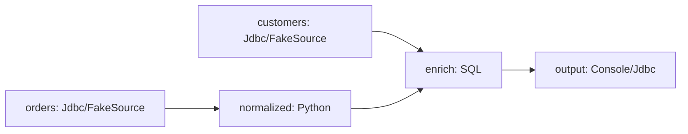

# Flink YAML DAG（实验性）

这组 API 面向 Flink 1.20.x 的验证场景。YAML 只描述节点和 `inputs`，运行时按节点 ID 推导依赖、做拓扑排序，并在同一个 `StreamExecutionEnvironment` 中注册所有算子，最后只调用一次 `execute`。



## YAML 结构

```yaml
nodes:
  orders:
    plugin: Jdbc
    operation: read
    config: { ... }
  normalize:
    plugin: Python
    operation: map
    inputs: [orders]
    config: { ... }
  enrich:
    plugin: sql
    operation: query
    inputs: [normalize, customers]
    config:
      query: SELECT ... FROM normalize JOIN customers ...
```

节点 ID 就是 SQL 中可引用的表名；`inputs` 支持列表，也支持把上游节点映射成 SQL 别名。`runtime.parallelism` 是可选的 Flink 并行度字段；FakeSource + Batch SQL 的本地验证示例设为 `1`，部署时可根据实际 source 和算子能力调整。解析器会拒绝未知的图、运行时和节点字段，但会把 `config` 交给对应插件继续校验。

当前支持的验证节点是 `FakeSource`、`Jdbc`、`Python`、`sql`、`Console` 和 `jdbc_action`。普通 JDBC source/sink 使用 SeaTunnel Connector-V2 的配置契约；Python 节点继续使用 `source_code` 或 `source_code_path`、`columns` 和 `process(row, context)`。SQL 一期只接受有界、insert-only 输入，适合 Batch INNER JOIN 等查询。

## 执行与边界

执行顺序由 DAG 推导，不依赖 YAML 节点的书写顺序。根节点的无输入控制动作会在 Flink 提交前执行；带完成值的终端动作会在 Flink 作业完成后执行。source、transform、SQL 和 sink 本身都属于数据图节点，控制动作不会被伪装成数据流。

前置动作可以通过 `inputs` 连接到 Source，后置校验可以通过 `inputs` 消费 Sink 的完成值。前置动作失败时不会提交 Flink 作业；数据作业失败时不会执行后置动作；后置动作失败会使整个任务失败。动作节点是任务级客户端编排动作，不是每条数据或每个 Flink subtask 的算子，也不与 checkpoint 或 Sink 事务绑定。

当前版本把完成边限制为 `COMPLETION ->` 终端客户端控制节点。一个 recon 节点可以同时消费多个 sink 的完成值；控制值和完成值不能混用。完成节点后面不能再连接新的数据节点，因为 Flink 作业已经在完成边生效前提交并结束。

节点扩展使用 Flink 1.20 starter 的 `GraphNodeProvider` ServiceLoader 接口。节点提供者必须声明唯一的 `plugin + operation`、输入输出能力和执行器；重复覆盖内置节点会在启动前失败。

本地验证使用 `/Users/xujiawei/software/flink/flink-1.20.5`，Python transform 还需要显式开启安全策略并配置解释器 allowlist。当前测试已经覆盖 YAML 解析、变量替换、依赖解析、环检测、能力校验、Python/SQL 节点契约和一次共享 Flink job submission。真实 PostgreSQL 运行还需要在目标部署中提供 PostgreSQL JDBC 驱动和对应 Connector 包；示例中的密码通过 `${PG_PASSWORD}` 传入，不写入仓库。
